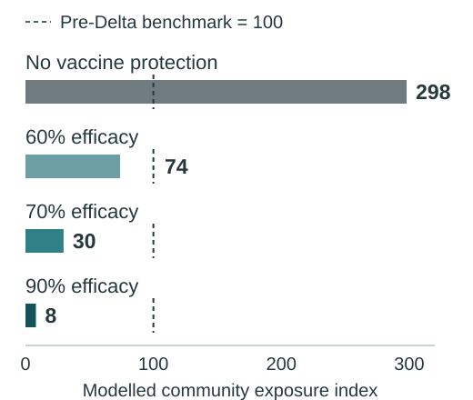

A flight home can mean a family reunion, a return to university or the chance to restart a job. During the pandemic, it could also carry an infection into a community with little local transmission. Vaccination raised an understandable question: if travellers were vaccinated, how much protection did border quarantine still need to provide?

That question mattered on both sides of the border. Restrictions kept people apart and limited travel, while an imported infection could put a wider community at risk. In their review of Delta, @he2021 summarised evidence of increased transmissibility and reduced vaccine effectiveness. These challenges complicated the hope that vaccination would make reopening straightforward.

Can vaccination make border quarantine safer, and is vaccinating travellers enough to protect the people they return to? A study by @zachreson2022 examined both parts of that question. Its findings help explain why a high vaccination percentage, on its own, tells us too little about the protection a border system provides.

## Following an infection from arrival to the community

The researchers used computer simulations to follow infections through managed quarantine and then into the community. One model represented travellers, workers, testing and isolation. A second followed the chains of infection that could begin after a breach, when an infected traveller or worker exposed people outside quarantine.

Those simulations drew on published estimates of infection progression, test sensitivity and vaccine effects. The team checked baseline behaviour against Australian quarantine breach reports collated by COVID Live, information from state health departments and official international-arrival statistics. The comparisons below are therefore model results, not counts from a trial of vaccinated travellers.

The models let the researchers separate three things often bundled together in public discussion: how readily the virus spreads, how much protection vaccination gives a person, and how many people in the community are vaccinated. Separating them reveals where vaccination helps, and where additional protection still matters.

## Better vaccine protection means less exposure

The first benefit appears before community spread begins. When vaccination makes infection less likely, fewer infections can pass through the quarantine system. @fig-exposure holds the virus at the same Delta-like level of transmissibility and changes vaccine efficacy: the reduction in susceptibility to infection provided by vaccination in the main model.

::: {.evidence-panel}
### Stronger vaccine protection lowers exposure {.unnumbered .unlisted}

Same Delta-like transmissibility in every bar: **R₀ = 6**.

{#fig-exposure fig-alt="Horizontal bars start at zero. Exposure index: no vaccine protection 298; 60 percent efficacy 74; 70 percent efficacy 30; 90 percent efficacy 8. Dashed markers show the benchmark of 100." width=560}

::: {.source-note}
**Source:** selected cells from Figure 3 in @zachreson2022, multiplied by 100 and rounded. These are exposure indices, not case counts or outbreak probabilities. Quarantine rules and strong infection control are held constant; travellers and workers are vaccinated in the vaccine scenarios. The benchmark is unvaccinated, pre-Delta transmission (R₀ = 3).
:::
:::

Without vaccine protection, the Delta-like scenario produces an exposure index of 298, almost three times the pre-Delta benchmark. With 70% efficacy, that index falls to about 30. This is a large reduction even though quarantine remains in place: vaccination is helping the system contain a more transmissible virus.

An index of 30 does not mean 30 cases or a 30% chance of an outbreak. It means the modelled potential for breaches to cause secondary infections is about 30% of the benchmark level. The measure allows a fair comparison between scenarios without pretending to predict a particular community’s case count.

This comparison answers the first part of the opening question: vaccination can make quarantine safer. However, the size of that improvement depends on the virus it is up against. Keeping vaccine protection the same while changing transmissibility shows why.

## A more transmissible virus can erode that gain

The same vaccine protection does not produce the same result against every virus. @tbl-scenarios keeps efficacy at 70% and changes the basic reproduction number, R₀. This number describes how many people one infected person would infect on average in a fully susceptible population without controls. Higher values mean greater transmission potential; they are not the number of people infected inside quarantine.

::: {.evidence-panel .scenario-panel}
| Virus scenario | Exposure index | What this means |
|:---|---:|:---|
| R₀ = 3 · Pre-Delta-like | 12 | Far below the benchmark |
| R₀ = 6 · Delta-like | 30 | Below the benchmark |
| R₀ = 8 · Higher spread | 64 | Still below, with less protection relative to the benchmark |
| R₀ = 10 · Higher spread | **117** | **Above the benchmark despite vaccination** |

: At the same vaccine efficacy (70%), more transmissible scenarios generate more exposure. The pre-Delta unvaccinated benchmark is 100. {#tbl-scenarios}
:::

::: {.source-note}
**Source:** selected cells from Figure 3 in @zachreson2022, multiplied by 100 and rounded. Vaccine efficacy is 70% throughout; all travellers and workers are vaccinated. Other model settings remain unchanged. Scenarios illustrate transmission differences, not observed estimates for four named variants.
:::

At the highest transmission level shown, exposure exceeds the old benchmark despite vaccination. That does not make vaccination ineffective: it shows why a promise of safe reopening cannot rest on vaccination status alone. The earlier reduction in @fig-exposure and the rising values in @tbl-scenarios describe two sides of the same result: vaccine protection and viral transmissibility must be considered together.

## Protection outside quarantine matters too

Even a well-performing quarantine system can allow an infection through. What happens next depends partly on the community that infection reaches. This is where coverage, the share of people vaccinated, becomes important alongside efficacy, the protection vaccination provides.

Real-world observations show why vaccination status alone cannot guarantee protection. @torres2022 documented Delta breakthrough infections in 39 of 201 vaccinated residents studied in two Spanish nursing homes. This older population differs from typical international travellers, so its infection rate should not be transferred to a border setting. The study illustrates that infections can still occur after vaccination; it does not validate the quarantine model’s numerical predictions.

## A longer delay is useful but not a guarantee

Returning to the community simulations in @zachreson2022, high coverage had much greater effects when vaccine efficacy was also high. With efficacy of at least 80%, the delay before outbreaks became likely rose sharply once coverage exceeded roughly 80%. At efficacy below 60%, increasing coverage produced much less improvement. A headline reporting high coverage therefore leaves an important question unanswered: how well is vaccination limiting transmission?

The researchers measured that delay as the time until the probability of at least one outbreak reached 50%. Using their Figure 4 definition, an outbreak was a cluster of at least five cases. Under favourable combinations of high coverage and efficacy, this time rose from roughly 15 days in the unvaccinated pre-Delta benchmark to the order of 1,000 days [@zachreson2022]. This is a comparison of risks, not a date on which an outbreak is predicted to happen.

Those waiting times depend on the arrival conditions. The community scenarios assumed 3,000 arrivals each week and a base infection prevalence of 10%, with vaccination affecting infection risk [@zachreson2022]. Different traveller volumes, prevalence or immunity could change the timing. The useful finding is that community vaccination can strengthen the protection provided at the border, especially when vaccines strongly reduce transmission.

That combined protection also depends on the quarantine facility. The main model assumes strong infection control, fixed vaccine efficacy and no waning within each scenario. When infection control was weakened, breach risk increased. The historical calibration was also imperfect: the model produced about 20 outbreaks compared with nine reported [@zachreson2022]. These limitations make the study more useful for comparing conditions than for promising how long a real community will remain outbreak-free.

## Safer borders depend on protection on both sides

Vaccination can make border quarantine safer, but vaccinating travellers alone cannot provide all the protection their destination needs. The study shows a benefit within quarantine, a loss of that benefit as the virus becomes more transmissible, and a further benefit when community coverage and vaccine efficacy are both high. Infection control remains part of that picture.

For readers weighing claims about reopening, the practical lesson is to ask what sits behind the vaccination percentage: protection against which variant, at what level of community coverage, and alongside which quarantine controls? Those questions make it easier to judge whether a claim addresses the risks to both travellers and the people they return to.

This Delta-era study does not establish current travel rules, individual protection or the economically best reopening policy. It does explain why vaccination and quarantine should be assessed together. The prospect of a flight home becomes safer when protection extends beyond the arriving passenger to the facility and the receiving community.

## Research behind this story {.unnumbered}

::: {#refs}
:::

[Back to all stories](../../index.qmd){.author-link}
